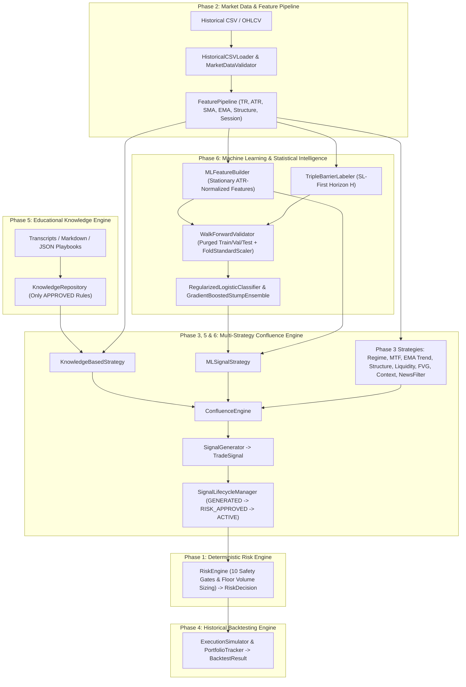

# ATLAS AI — SYSTEM ARCHITECTURE

---

## 1. Architectural Philosophy

ATLAS AI is built around **strict separation of concerns**, **zero lookahead bias**, and **deterministic trading safety**:
- **Knowledge, Statistical/ML & Strategy Engines Identify Opportunities; Risk Engine Decides Permissibility.** Every generated signal starts in `GENERATED` state and can never become `ACTIVE` without passing through the standalone Phase 1 `RiskEngine`.
- **Causal & Purged Evaluation Only:** Every feature, strategy, knowledge rule, and ML inference step at bar $t$ operates strictly on closed historical bars $\le t$, and every supervised ML training split enforces `purge_bars >= horizon_bars`.

---

## 2. High-Level System Data Flow (Phases 0–6)



---

## 3. Current Folder Structure (Phase 6)

```text
c:\Users\User\OneDrive\Desktop\ATLAS AI\
├── .env.example
├── .gitignore
├── pyproject.toml
├── README.md
├── PROJECT_CONTEXT.md
├── ARCHITECTURE.md
├── DEVELOPMENT_LOG.md
├── NEXT_STEPS.md
├── CHANGELOG.md
├── src/
│   └── atlas_ai/
│       ├── __init__.py
│       ├── main.py
│       ├── core/
│       ├── domain/
│       ├── risk/
│       ├── data/
│       ├── strategies/
│       ├── backtest/
│       ├── knowledge/
│       └── models/
│           ├── __init__.py
│           ├── exceptions.py
│           ├── config.py
│           ├── schemas.py
│           ├── labeling.py
│           ├── features.py
│           ├── classifiers.py
│           ├── validation.py
│           └── strategy.py
└── tests/
    ├── __init__.py
    ├── fixtures/
    │   └── synthetic_xauusd_h1.csv
    ├── test_foundation.py
    ├── test_domain_and_risk.py
    ├── test_market_data.py
    ├── test_features.py
    ├── test_strategies.py
    ├── test_smc_ict.py
    ├── test_multi_timeframe.py
    ├── test_news_filter.py
    ├── test_confluence.py
    ├── test_signal_generation.py
    ├── test_signal_lifecycle.py
    ├── test_backtest.py
    ├── test_knowledge.py
    └── test_models.py
```
